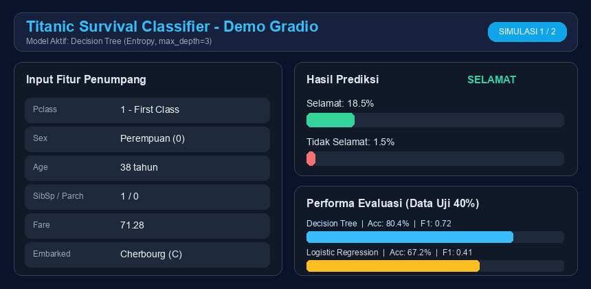
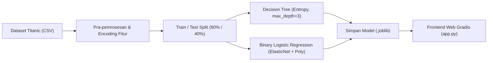

<p align="center">
  
</p>

<p align="center">
  
  
  
</p>

Project Machine Learning untuk memprediksi keselamatan penumpang kapal Titanic (**Selamat** atau **Tidak Selamat**) menggunakan **Decision Tree** dan **Binary Logistic Regression**, dilengkapi antarmuka web interaktif berbasis **Gradio**.

---

## Demo Animasi & Performa

<p align="center">
  
</p>

---

## Alur Kerja Sistem



---

## Struktur Project

```text
.
├── assets/
│   ├── banner.svg                     # Banner header animasi
│   └── demo.gif                       # Animasi simulasi prediksi & performa model
├── models/                            # Model terlatih (.joblib, dibuat otomatis saat training)
├── titanic-survival-classifier.ipynb  # Notebook eksplorasi, pelatihan, evaluasi & visualisasi
├── train.py                           # Skrip pelatihan & penyimpanan model ke models/
├── app.py                             # Aplikasi web interaktif Gradio
├── requirements.txt                   # Daftar dependensi Python
├── .gitignore                         # Daftar file/folder yang diabaikan Git
└── README.md                          # Dokumentasi project
```

---

## Fitur Input & Encoding

Model menerima 7 fitur penumpang setelah kolom `Name`, `Ticket`, `Cabin`, dan `PassengerId` dihapus:

| Fitur | Tipe | Keterangan & Nilai Encoding |
|---|---|---|
| `Pclass` | Numerik | Kelas tiket (`1` = First Class, `2` = Second Class, `3` = Third Class) |
| `Sex` | Kategorikal -> Numerik | Jenis kelamin (`1` = Laki-laki, `0` = Perempuan) |
| `Age` | Numerik | Usia penumpang dalam tahun (missing value diisi `0`) |
| `SibSp` | Numerik | Jumlah saudara kandung atau pasangan di kapal |
| `Parch` | Numerik | Jumlah orang tua atau anak di kapal |
| `Fare` | Numerik | Harga tiket penumpang |
| `Embarked` | Kategorikal -> Numerik | Pelabuhan keberangkatan (`1` = Cherbourg, `2` = Queenstown, `3` = Southampton, `0` = Tidak Diketahui) |

---

## Perbandingan Model

Kedua model dilatih pada pembagian dataset 60% data latih dan 40% data uji (`test_size=0.4`, `random_state=0`):

| Model | Konfigurasi Utama | Accuracy | F1-Score |
|---|---|---:|---:|
| **Decision Tree** | `criterion="entropy"`, `max_depth=3`, `min_samples_leaf=3`, `max_leaf_nodes=5` | **0.8039** | **0.7200** |
| **Binary Logistic Regression** | `PolynomialFeatures` + `LogisticRegression(solver="saga", l1_ratio=0.5, max_iter=1000)` | 0.6723 | 0.4121 |

---

## Cara Penggunaan

### 1. Siapkan Virtual Environment & Install Dependensi

```bash
python3 -m venv .venv
source .venv/bin/activate
pip install -r requirements.txt
```

### 2. Latih & Simpan Model (Opsional)

Jalankan skrip training untuk menghasilkan file `.joblib` di folder `models/` (membutuhkan koneksi internet untuk mengunduh dataset sumber):

```bash
python train.py
```

> Jika langkah ini dilewati, `app.py` akan menjalankan training secara otomatis saat pertama kali dibuka apabila folder `models/` belum memiliki model.

### 3. Jalankan Frontend Gradio

```bash
python app.py
```

Setelah server aktif, buka URL lokal yang tampil di terminal (default: `http://127.0.0.1:7860`) di browser Anda:
1. Pilih model (`Decision Tree` atau `Binary Logistic Regression`).
2. Isi profil penumpang atau klik salah satu contoh data di bagian **Examples**.
3. Klik **Prediksi** untuk melihat status keselamatan beserta probabilitasnya.

### 4. Menjalankan Notebook

Buka `titanic-survival-classifier.ipynb` di Jupyter Notebook, JupyterLab, atau VS Code menggunakan kernel `.venv` untuk melihat detail eksplorasi data, confusion matrix, ROC/AUC, dan visualisasi pohon keputusan.
